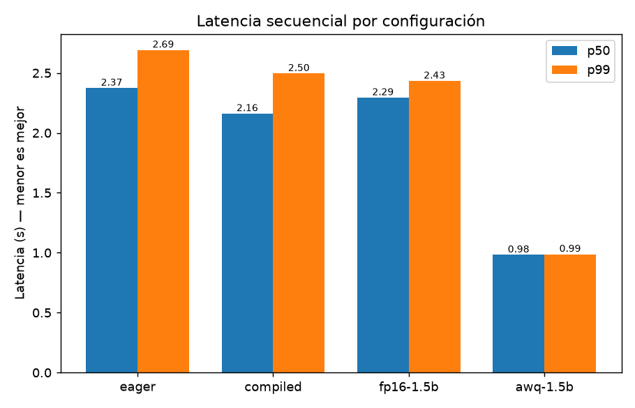
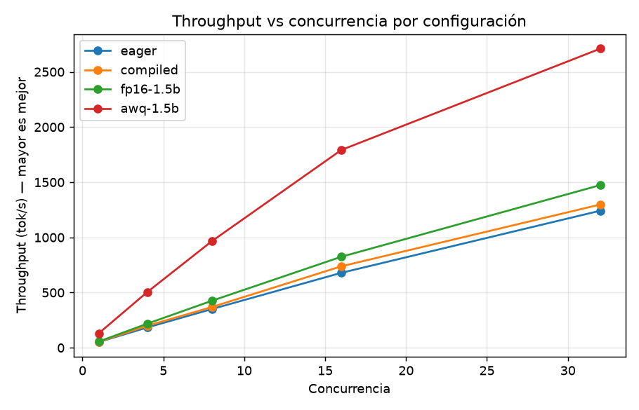

# llm-inference-optimization

Lowering latency and cost of an LLM inference server, measured **before vs after**.
Each experiment changes **one variable** and reports the honest, output-normalized metric.

Builds on [llm-serving-vllm](https://github.com/garren30/llm-serving-vllm) — vLLM behind
an OpenAI-compatible API, containerized, on Kubernetes — which provides the measured
baseline this repo optimizes against.

> **AWQ 4-bit (same 1.5B model): 2.3× lower latency and 2.7× more serving
> capacity on a 6 GB GPU — weights 2.98 → 1.1 GiB, max concurrency 9× → 25×.**

---

## Hardware & stack
RTX 4050 Laptop GPU (Ada, ~6 GB VRAM) · WSL2 Ubuntu · vLLM 0.33 · Qwen2.5-1.5B-Instruct.

## Baseline (from the serving project)
| metric | value |
|---|---|
| sequential throughput | ~53.7 tok/s |
| p99 latency (sequential) | ~2.45 s |
| decode cost | ~18.4 ms/token |
| throughput ceiling | ~2250 tok/s (saturates ~64 concurrent) |

---

## Experiment 2 — AWQ 4-bit quantization

**Why:** at batch=1 decode is memory-bound reading weights. AWQ stores weights
in 4-bit (activation-aware: it protects the salient weights), so fewer bytes are
read per token — and the freed VRAM becomes KV cache, i.e. serving capacity.

### Speed (same 1.5B model, fp16 vs AWQ)
| config    | p50 (s) | p99 (s) | tok/s seq | tok/s @ conc32 |
|-----------|---------|---------|-----------|----------------|
| fp16-1.5b | 2.29    | 2.43    | 55.6      | 1473.6         |
| awq-1.5b  | 0.98    | 0.99    | 130.2     | 2710.0         |

### VRAM & capacity (from vLLM startup logs)
| config    | weights  | free KV cache | max concurrency (4096 tok) |
|-----------|----------|---------------|-----------------------------|
| fp16-1.5b | 2.98 GiB | 1.01 GiB      | 9.19×                       |
| awq-1.5b  | 1.1 GiB  | 2.72 GiB      | 24.84×                      |




**Result:** 2.34× lower latency and 2.7× more serving capacity on the same 6 GB
card, same model — no quality loss (AWQ preserves the salient weights).

**The nuance that matters:** the speedup *narrows* with concurrency (2.33× at
conc 1 → 1.84× at conc 32). At batch=1 we're memory-bound on weight reads, where
4-bit wins most; at high batch the weights are amortized across sequences, the
workload turns compute-bound, and dequantization overhead starts to show. A
textbook memory-bound → compute-bound transition, measured on real hardware.

> Served without `--quantization awq` so vLLM auto-selects the fast **Marlin**
> kernel. Weights shrink 2.7× (not the theoretical 4×) because
> embeddings/layernorms/lm_head stay fp16 and AWQ keeps per-group scales/zeros.

---

## Experiment 1 — compile on/off (`--enforce-eager`)

Removing `--enforce-eager` lets vLLM capture **CUDA graphs** (replay the kernel
sequence in one launch) and run **torch.compile** (fuse ops), cutting CPU→GPU
dispatch overhead in single-request decode.

| config   | p50 (s) | p99 (s) | tok/s seq | tok/s @ conc32 |
|----------|---------|---------|-----------|----------------|
| eager    | 2.37    | 2.69    | 50.2      | 1241.7         |
| compiled | 2.16    | 2.50    | 53.1      | 1297.6         |

**Result:** +5.8% sequential throughput, up to +8.7% under concurrency, **zero
VRAM cost** — a free win on a 1.5B model, larger on bigger/compute-bound models.

**Honest-metric note:** the raw p50 drop (~9%) was inflated by variable output
length (`temperature 0.7`); throughput normalizes for that. Fixed afterward with
`ignore_eos` (every request emits exactly 128 tokens).

---

## Roadmap
- **Experiment 2b — 7B-AWQ:** fit a 7B model on the 6 GB card, where 7B-fp16
  (~14 GB) would OOM. The capability-unlock headline.
- **Experiment 3 — prefix/KV caching · model routing.**

---

## How to run
```bash
# Terminal 1 — serve a config
bash serve_compiled.sh                                   # fp16 1.5B (baseline)
vllm serve Qwen/Qwen2.5-1.5B-Instruct-AWQ